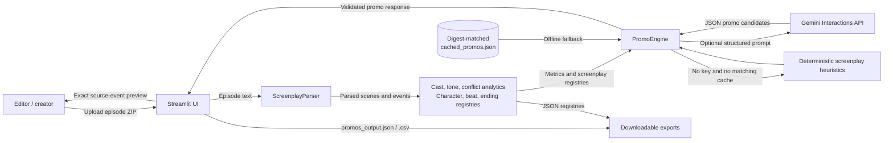
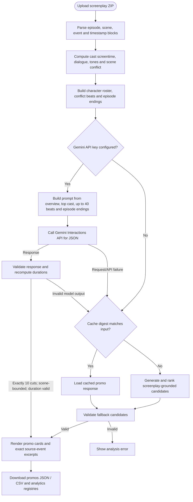

# Kuku Microdrama Promo Finder

A Streamlit prototype that parses timestamped screenplay episodes, computes cast
and conflict analytics, and ranks ten 20–60 second vertical-video promo cuts.
It can use Gemini when configured, or run with the validated local heuristics
and a screenplay-specific cache.

## System design

The interactive, repository-grounded component diagram is available as
[system-architecture.html](./docs/system-architecture.html). The source
specification is [system-architecture-final.architecture.json](./system-architecture-final.architecture.json).



### Promo-generation data flow



## Promo-selection assumptions and decisions

These are implementation rules and assumptions, not empirically measured ad
performance claims:

- **Timecode arithmetic:** `MM:SS.ss` values are seconds on each episode's
  timeline. A stitched promo's duration is the sum of its selected segments;
  time between episodes or segments is not counted.
- **Hard duration gates:** Every promo totals 20–60 seconds. A continuous
  single-scene cut is further constrained to 25–55 seconds. Each segment must
  fit inside one parsed scene, and its duration is recomputed from its in/out
  points rather than trusted from model output.
- **Opening hook:** Hook events are selected from configured disruption words
  (such as betrayal, rejection, arrest, threats) or selected high-drama tone
  tags. The hook event must start within three seconds of its scene's start.
  This is a lexical/tone proxy for an immediate visual or emotional disruption.
- **Cliffhanger:** Candidate endings use reveal/threat/proposal vocabulary,
  selected dramatic tone tags, or dialogue containing a question. Those cues
  locate potential unresolved beats; they do not prove that the scene is a
  true cliffhanger without editorial review.
- **Cut types:** Type A is one continuous scene. Type B stitches two segments.
  The offline generator targets an 8–14 second opening segment and a 15–18
  second ending segment; the latter is capped at 18 seconds by its cut-point
  selection rule. Both remain subject to the 20–60 second total.
- **Ranking is heuristic:** Offline candidates are scored from scene conflict
  intensity and hook/cliffhanger keyword and tone matches, then sorted. The
  score is not a trained conversion model and has not been calibrated against
  click-through, install, or retention data. Gemini's conversion rationale is
  a creative estimate, not a performance forecast.
- **Diversity and fallback:** The offline ranker first limits repeated starts
  to two candidates per episode and avoids reusing exact hook/end points; it
  relaxes the episode cap only if needed to reach ten. If cue-based candidates
  are insufficient, it can use a continuous scene excerpt, which is marked for
  editorial review rather than treated as a verified hook/cliffhanger.
- **Source-text fidelity:** The UI excerpt is looked up from parsed screenplay
  events, not copied from model prose. The model may suggest cut descriptions
  and summaries, but timestamps must map to parsed scene ranges before output.
- **Character screentime proxy:** Active duration is the union of explicitly
  timestamped dialogue and action intervals where a character is named or
  speaking. It is not computer-vision measurement of actual on-screen pixels;
  overlapping intervals are counted once per character per episode.
- **Offline cache scope:** A cached response is used only when its SHA-256
  digest matches the exact input archive. Different ZIP bytes, even with the
  same episode text, do not qualify for that cache and use offline heuristics
  instead.
- **LLM input and privacy:** With a key configured, the prompt sends analytics
  and screenplay-derived registry text (including selected beat text and
  episode-ending excerpts) to Gemini. The full uploaded archive is parsed
  locally and is not included wholesale in the prompt. Upload only scripts you
  are authorized to process with the configured provider.

## Known limitations

- There is no video, audio, or edit-timeline analysis; screenplay timestamps
  and sound-effect descriptions may not reflect the final production.
- Keyword scoring can miss context, interpret common wording as conflict, or
  mistake a question for an unresolved cliffhanger.
- A model response can fail schema/timestamp validation and fall back to the
  cache or offline candidates; fallback results still need editorial judgment.
- Standalone comprehension and emotional impact require human review. The
  prototype does not predict actual platform conversion or guarantee ten
  compelling promos for arbitrary scripts.

## Run locally

1. Use Python 3.10 or later.
2. From this folder, install dependencies:

   ```powershell
   python -m pip install -r requirements.txt
   ```

3. Add a Gemini key to `.env` if desired. Set `GEMINI_MODEL` to the model name
   available to your API key (default: `gemini-3.8-flash`). The key is read from
   `.env` and is never shown in the dashboard. Leave it blank for offline mode.
4. Start the dashboard:

   ```powershell
   streamlit run app.py
   ```

The app uses the sibling `I Married a Broken Soldier. He was a Duke-script.zip`
by default, or accepts an uploaded `.zip` of episode `.txt` files. Analysis
artifacts are written to `outputs/`, which is ignored by Git.

## Deploy on Streamlit Community Cloud

Live app: https://kukupromofinder-8ay8irvrkpuqshzaqfactt.streamlit.app/

1. Push this repository to GitHub without adding `.env` or screenplay files.
2. In Streamlit Community Cloud, create an app from this repository and select
   `app.py` as the entry point.
3. Add `GEMINI_API_KEY` and optionally `GEMINI_MODEL` in the app's Secrets
   settings. Never commit API keys to GitHub.
4. Open the deployed app and upload a screenplay ZIP to analyze it.

## Validation and exports

Every candidate's timestamps must fit within a parsed scene, and segment
durations are recomputed from those timestamps. Promos outside 20–60 seconds
are rejected. Screenplay excerpts are populated from source events rather than
LLM-generated text. The dashboard provides `promos_output.json` and
`promos_output.csv` downloads, plus the cast, beat, and episode-ending
registries in `outputs/`.
